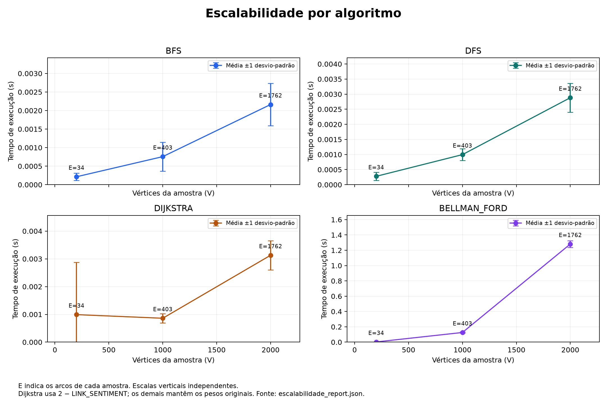

# Desempenho e escalabilidade

## Objetivo

Para medir o desempenho, executamos os algoritmos BFS, DFS, Dijkstra e Bellman-Ford em três tamanhos de grafo. Em cada tarefa, fizemos cinco execuções e calculamos o tempo médio. Também registramos os tempos individuais e o desvio-padrão amostral.

## Ambiente e método de medição

As medições de escalabilidade foram realizadas em 24/11/2026, utilizando CPython 3.12.14, Windows 11 e arquitetura AMD64. O processador foi identificado pelo sistema como Intel64 Family 6 Model 154 Stepping 4, GenuineIntel.

Utilizamos `time.perf_counter()` para marcar o início e o fim de cada chamada do algoritmo. A diferença entre essas marcações corresponde ao tempo de execução em segundos.

A leitura dos dados, a construção das amostras, a transformação dos pesos, a impressão e a exportação ficaram fora da medição. As validações internas e a preparação das estruturas realizadas dentro de cada algoritmo foram incluídas. As chamadas ocorreram em sequência, sem etapa de aquecimento separada.

O tempo médio foi calculado pela soma dos cinco tempos dividida por cinco. Os resultados completos estão em [escalabilidade_report.json](../out/parte2/escalabilidade_report.json). O arquivo também registra o ambiente, o hash da entrada e os hashes dos arquivos de código utilizados. Como havia alterações locais durante a execução, o commit registrado deve ser consultado junto desses hashes.

## Recorte e amostragem

A base preparada do Reddit contém 54.075 vértices e 571.927 arcos. Para executar os quatro algoritmos nos três tamanhos, utilizamos um recorte de 2.000 vértices. Esse limite foi adotado para controlar o custo das repetições de Bellman-Ford na presença de ciclos negativos.

Mantivemos a origem `subredditdrama` e selecionamos os outros 1.999 vértices por uma permutação aleatória com semente 42. O recorte preservou os arcos originais cujas duas pontas estavam entre os vértices selecionados, incluindo seus pesos e direções.

Depois, geramos amostras com 10%, 50% e 100% dos vértices desse recorte. A origem foi mantida nas três amostras. As seleções são aninhadas: os vértices da menor amostra também pertencem às maiores. A ordem original dos vértices e dos arcos foi preservada na construção dos subgrafos.

| Proporção do recorte | Vértices | Arcos | Vértices alcançáveis desde a origem | Arcos negativos |
|---|---:|---:|---:|---:|
| 10% | 200 | 34 | 8 | 8 |
| 50% | 1.000 | 403 | 40 | 118 |
| 100% | 2.000 | 1.762 | 108 | 442 |

Os percentuais se referem ao recorte de 2.000 vértices, não à base inteira. A reprodução depende do mesmo arquivo de entrada, de sua ordem de leitura, da semente e dos parâmetros utilizados.

## Execução dos algoritmos

Os quatro algoritmos receberam os mesmos vértices, arcos e origem em cada tamanho. BFS, DFS e Bellman-Ford utilizaram os pesos originais de sentimento. Dijkstra utilizou a transformação `2 - LINK_SENTIMENT`, já adotada nos experimentos do grupo: o peso original +1 passou a 1, e o peso original -1 passou a 3.

As funções foram executadas a partir da origem para os vértices alcançáveis, sem interrupção em um destino específico. Bellman-Ford detectou ciclo negativo alcançável nas três amostras. Seus tempos incluem a detecção, a reconstrução de um ciclo e a identificação dos vértices afetados. Nas outras chamadas, o status registrado foi `OK`.

Ao todo, foram realizadas 60 execuções de escalabilidade: quatro algoritmos, três tamanhos e cinco repetições por combinação.

## Resultados registrados

A tabela apresenta os tempos em milissegundos, convertidos dos valores em segundos armazenados no JSON. O desvio-padrão descreve a dispersão entre as cinco execuções; não representa um intervalo de confiança.

| Algoritmo | Vértices | Arcos | Tempo médio (ms) | Desvio-padrão (ms) |
|---|---:|---:|---:|---:|
| BFS | 200 | 34 | 0,213700 | 0,095848 |
| BFS | 1.000 | 403 | 0,756640 | 0,390009 |
| BFS | 2.000 | 1.762 | 2,162740 | 0,573170 |
| DFS | 200 | 34 | 0,277040 | 0,135714 |
| DFS | 1.000 | 403 | 0,996380 | 0,198580 |
| DFS | 2.000 | 1.762 | 2,882280 | 0,478846 |
| Dijkstra | 200 | 34 | 0,991600 | 1,880197 |
| Dijkstra | 1.000 | 403 | 0,860580 | 0,165808 |
| Dijkstra | 2.000 | 1.762 | 3,129820 | 0,523621 |
| Bellman-Ford | 200 | 34 | 2,535280 | 0,405653 |
| Bellman-Ford | 1.000 | 403 | 126,182340 | 6,926203 |
| Bellman-Ford | 2.000 | 1.762 | 1.281,031980 | 43,607727 |

Cada painel mostra os tempos de um algoritmo, com média e um desvio-padrão amostral. Os eixos verticais possuem escalas independentes; a altura visual das curvas de painéis diferentes não deve ser comparada diretamente. As marcações E indicam a quantidade de arcos em cada amostra.

## Referências para a comparação teórica

As funções de referência abaixo correspondem às implementações utilizadas, incluindo a construção de adjacência a partir da lista de arestas.

| Algoritmo | Limite assintótico de tempo considerado |
|---|---|
| BFS | O(V + E) |
| DFS iterativo | O(V + E) |
| Dijkstra com heap e entradas repetidas | O(V + E + E log(E + 1)) |
| Bellman-Ford | O(VE + V + E) |

Na implementação de Dijkstra, o heap pode conter entradas repetidas e o grafo permite arcos paralelos. Por isso, a referência utiliza log(E + 1). Em Bellman-Ford, a fila inicial de propagação dos ciclos negativos foi deduplicada antes das medições registradas.

A [tabela de comparação](../out/parte2/comparacao_complexidades.csv) contém os fatores calculados e as razões em relação ao menor tamanho de cada algoritmo. Esses fatores não são contagens exatas de operações nem previsões de tempo em segundos.

## Limitações do experimento

O recorte usa uma origem e uma semente. As amostras não garantem conectividade, e a quantidade de vértices alcançáveis é diferente da ordem total do grafo. O tempo medido inclui a preparação interna das estruturas, além da exploração.

As tarefas também possuem diferenças: BFS busca caminhos com menos arestas; DFS realiza exploração e classificação; Dijkstra usa pesos transformados; Bellman-Ford trabalha com os pesos assinados e, nestes casos, detecta ciclos negativos. Os tempos não demonstram equivalência entre os objetivos desses algoritmos.

No menor caso de Dijkstra, os cinco tempos foram aproximadamente 4,355; 0,158; 0,148; 0,189 e 0,108 ms. Todos foram mantidos na média. A variação das chamadas, o computador e outros processos em execução devem ser considerados ao discutir os resultados.

## Discussão dos resultados

O tempo de BFS e DFS aumentou nas amostras maiores. Entre 200 e 2.000 vértices, o tempo médio cresceu cerca de dez vezes nos dois algoritmos. Nesse intervalo, a soma V + E passou de 234 para 3.762, um aumento de aproximadamente 16 vezes. Os tempos não acompanharam essa proporção de forma exata. A referência O(V + E) descreve o crescimento do custo, mas não determina um tempo fixo para cada entrada.

Também aumentou o número de vértices alcançáveis: eram 8 na menor amostra e 108 na maior. Por isso, a comparação precisa considerar o tamanho total, a quantidade de arcos e a parte da rede explorada. As duas implementações preparam a adjacência do grafo antes da busca, mesmo quando muitos vértices são inalcançáveis. Embora tenham a mesma referência de complexidade, DFS ainda registra tempos de descoberta e finalização e classifica os arcos; BFS registra distâncias e predecessores. Isso impede tratar as duas tarefas como operações idênticas.

Dijkstra teve uma média um pouco menor na amostra de 1.000 vértices do que na de 200. Isso não significa que aumentar o grafo tornou o algoritmo mais rápido. Na menor amostra, uma execução levou aproximadamente 4,355 ms, enquanto as outras ficaram entre 0,108 e 0,189 ms. Essa execução elevou a média e o desvio-padrão. Mantivemos os cinco valores, sem remover a medição mais alta, pois não foi identificada uma causa que justificasse sua exclusão.

Na amostra de 2.000 vértices, Dijkstra levou em média 3,130 ms. O aumento em relação à menor amostra foi de aproximadamente 3,16 vezes, enquanto a função de referência utilizada cresceu cerca de 55,74 vezes. Essa diferença não demonstra uma contradição com a complexidade teórica. O limite considera um custo assintótico, enquanto o trabalho com o heap depende das relaxações e dos vértices alcançados na entrada concreta. Os tempos curtos e a variação entre chamadas também limitam a comparação dessas razões.

Bellman-Ford apresentou o maior crescimento de tempo neste experimento. Na menor amostra, levou cerca de 2,535 ms; na maior, aproximadamente 1,281 segundo. O tempo médio aumentou cerca de 505 vezes, e o fator VE + V + E aumentou aproximadamente 502 vezes. Nas três amostras havia ciclo negativo alcançável, impedindo a parada antecipada por ausência de melhorias. O crescimento observado é compatível com o custo das passagens repetidas pelas arestas, mas três tamanhos de uma origem e uma semente não comprovam a complexidade teórica nem representam todas as redes possíveis.

Os resultados permitem comparar os tempos registrados nas condições descritas, mas não escolher um algoritmo apenas pela velocidade. Os algoritmos respondem a objetivos diferentes e Dijkstra utiliza outros pesos. A escolha também precisa considerar a pergunta que se deseja responder, a existência de pesos negativos e a necessidade de detectar ciclos. Para este estudo, os tempos, as tarefas executadas e as limitações das amostras devem ser apresentados em conjunto.
